# 拾光 · 回忆录工坊 — 产品简介

> 面向口述回忆录生产的智能体矩阵 + 一体化可视化工作台。
> 把一段访谈录音（含方言），变成一本可付印的书稿。

---

## 一、是什么

### 一句话

**拾光 · 回忆录工坊** 是一款 **Web 端（桌面优先、兼顾移动端）的一体化可视化工作台**，它把「访谈录音 → 可付印书稿」这条原本要反复切换录音软件、转写工具、文档编辑器和排版软件的长链路，拆成 **12 个职责单一的智能体**，用一条可视化流水线串起来——每一步都可查看、可修改、可回退。

### 它解决的核心问题

| 痛点 | 现状 | 拾光的解法 |
|---|---|---|
| 工具割裂 | 录音、转写、编辑、排版分散在 5+ 个软件，来回导文件 | 一条流水线贯通，同一项目内流转 |
| 方言难懂 | 普通话转写对方言（粤语、四川话、吴语等）识别率低 | 每条录音可指定方言，方言词单独标注 |
| 气口水词多 | 口述「嗯、啊、就是说、那个」充斥成稿 | 三档气口清理，展示清理前后字数与删除条数 |
| 不会讲故事 | 原始口述是流水账，缺结构、缺主题 | 故事勘探员提炼 logline / 主题 / 时间轴 / 实体 / 金句，结构建筑师搭章节骨架 |
| 风格不可控 | AI 生成腔重、文风飘忽 | 5 种叙事结构 × 5 种文风可组合、可切换重写 |
| 配图难 | 找不到贴合私人记忆的插图 | 6 种画风 × 可重生成，封面与章节插图全部内联生成 |
| 交付散 | 书稿、配置、运行记录各存各的 | 一键导出 Markdown / 自包含 HTML / project.json / agent-run.json，可 ZIP 打包、可推送到 GitHub |

### 产品形态与技术边界

- **形态**：纯前端 React SPA，无后端、无服务器。
- **数据**：项目与配置持久化在浏览器 `localStorage`，数据不出本机；API Key 仅存本地浏览器。
- **模型**：文本 / 语音 / 图像三类能力均可各自选择**国内大模型**厂商与具体模型并填入 API Key；未配置时自动降级为离线演示模拟，保证流程可走通、可演示。
- **不做**：登录注册、云端同步、社区、电商、真实支付、多用户协作。

> 本文档中的截图均来自内置演示项目《炉火与远方》（虚构示例），仅用于说明界面与功能。

---

## 二、面向谁

### 核心目标用户

1. **回忆录整理者 / 家属** —— 想为父母、祖辈留下一本像样的回忆录，但不熟悉专业出版流程的普通人。
2. **小型出版工作室 / 独立编辑** —— 承接个人史、家族史、企业口述史项目，需要可批量复制的生产流水线。
3. **口述史 / 非虚构写作者** —— 有大量访谈素材，需要快速从录音走到结构化初稿。

### 讲述者特征

- 多为 **60–90 岁长者**，口音重、节奏慢、常有重复与插叙；
- 录音可能是 **方言**（粤语、四川话、吴语/上海话、闽南语、东北话、客家话等）；
- 涉及创伤记忆时，界面保留「需经讲述者与家属确认」的提示。

### 典型使用场景

**场景 A · 子女为父亲做一本回忆录**
> 小林用手机录下 82 岁父亲陈守义讲述三线建设经历的 3 段录音（共 132 分钟），导入拾光，选「四川话」转写，清理气口，提炼出「炉火与远方」的主题，按编年体生成 5 章初稿，配上木刻版画风格插图，导出一本可付印的 HTML 书稿送给父亲。

**场景 B · 工作室批量承接口述史项目**
> 某工作室同时跟进 4 位客户的回忆录，在工作台分别建项目，统一配置好 DeepSeek（文本）+ 阿里百炼（语音）+ 即梦 Seedream（图像）的模型密钥，按流水线分工协作，每个项目的 agent-run 记录可追溯每一步用了哪个模型、哪一版。

**场景 C · 个人口述史作者打磨素材**
> 作者有 20 小时访谈录音，先用「深」档气口清理得到干净语料，再在编排室尝试「双线并行」与「主题式」两种结构对比，选定后切换「文学散文」文风重写，并逐章在纸面编辑器中精修。

---

## 三、功能

### 3.1 功能全景：一条流水线，十二个智能体

```mermaid
flowchart LR
  subgraph S0["工作台 · 全局总览"]
    WB["项目管理 / 进度 / 智能体在岗 / 质量检查"]
  end
  subgraph S1["01 采集 · Capture"]
    A1["A01 声音清道夫"]
    A2["A02 方言听写员"]
  end
  subgraph S2["02 转写 · Transcript"]
    A3["A03 角色分辨师"]
    A4["A04 气口编辑"]
  end
  subgraph S3["03 编排 · Compose"]
    A5["A05 故事勘探员"]
    A6["A06 结构建筑师"]
  end
  subgraph S4["04 撰写 · Write"]
    A7["A07 执笔人"]
    A8["A08 事实校对"]
  end
  subgraph S5["05 出版 · Publish"]
    A9["A09 封面画师"]
    A10["A10 插图师"]
    A11["A11 版面匠"]
  end
  subgraph S6["交付 · Deliver"]
    A12["A12 出版管家"]
  end
  WB --> S1 --> S2 --> S3 --> S4 --> S5 --> S6
```

### 3.2 用户使用路径

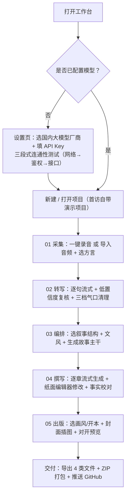

### 3.3 工位功能清单

| 工位 | 路由 | 核心功能 | 负责智能体 |
|---|---|---|---|
| 工作台 | `/` | 多项目管理、流水线进度、智能体在岗状态、交付质量检查、今日工作记录 | 全局 |
| 01 采集台 | `/capture` | 一键录音（`getUserMedia`）、音频文件导入、无麦克风降级演示录音、7 种方言切换、素材库管理 | A01、A02 |
| 02 转写台 | `/transcript` | 逐句流式转写、说话人/时间/置信度、置信度 <0.8 可复核、气口清理三档（轻/标准/深）、清理前后字数与删除条数、方言词单独标注 | A03、A04 |
| 03 编排室 | `/compose` | 5 套叙事结构、5 种文风、故事主干（logline/主题/时间轴/人物·地点·物件/金句/章节骨架） | A05、A06 |
| 04 撰写室 | `/write` | 逐章流式生成（可见过程）、纸面编辑器直接修改、切换文风按新文风重写、事实校对单独成块 | A07、A08 |
| 05 出版工坊 | `/publish` | 6 种画风、3 种开本、封面工作室（重生成）、A5 对开预览、章节插图网格、印刷预估 | A09、A10、A11 |
| 交付与归档 | `/deliver` | 导出 Markdown / 自包含 HTML / project.json / agent-run.json、ZIP 打包、填 Token 推送 GitHub | A12 |
| 智能体矩阵 | `/agents` | 12 个智能体全量说明（职责、输入、输出、默认模型） | 全量 |
| 开源技能 | `/skills` | Skill 仓库说明 | 全量 |
| 模型设置 | `/settings` | 文本/语音/图像三类，厂商→模型两级选择、API Key 配置、三段式连通性测试 | — |

**可选项明细**

- **方言（7 种）**：普通话 / 粤语 / 四川话 / 吴语（上海话）/ 闽南语 / 东北话 / 客家话
- **叙事结构（5 套）**：编年体 / 双线并行 / 主题式 / 口述实录 / 书信体
- **文风（5 种）**：克制纪实 / 温暖抒情 / 文学散文 / 幽默口语 / 史诗厚重
- **画风（6 种）**：木刻版画 / 水彩纪事 / 银盐胶片 / 水墨留白 / 复古丝网印 / 油画肖像
- **开本（3 种）**：A5 精装 / 32 开文库 / 16 开画册
- **模型厂商**：文本 11 家、语音 4 家、图像 5 家，共 50+ 国内模型可选（详见 [模型选型清单](./model-provider-matrix.md)）

### 3.4 产品截图

#### 工作台 · `/`
流水线进度、智能体在岗、交付检查一屏总览。

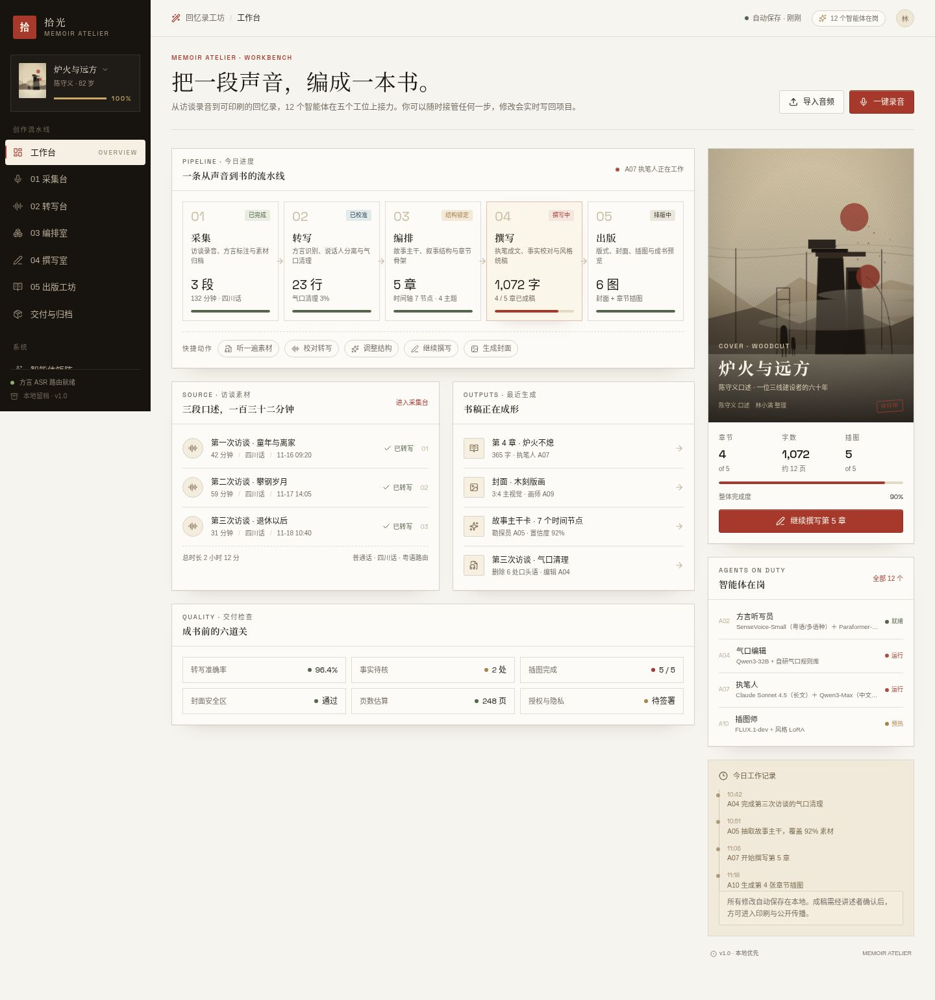

#### 01 采集台 · `/capture`
一键录音与音频导入，7 种方言路由。

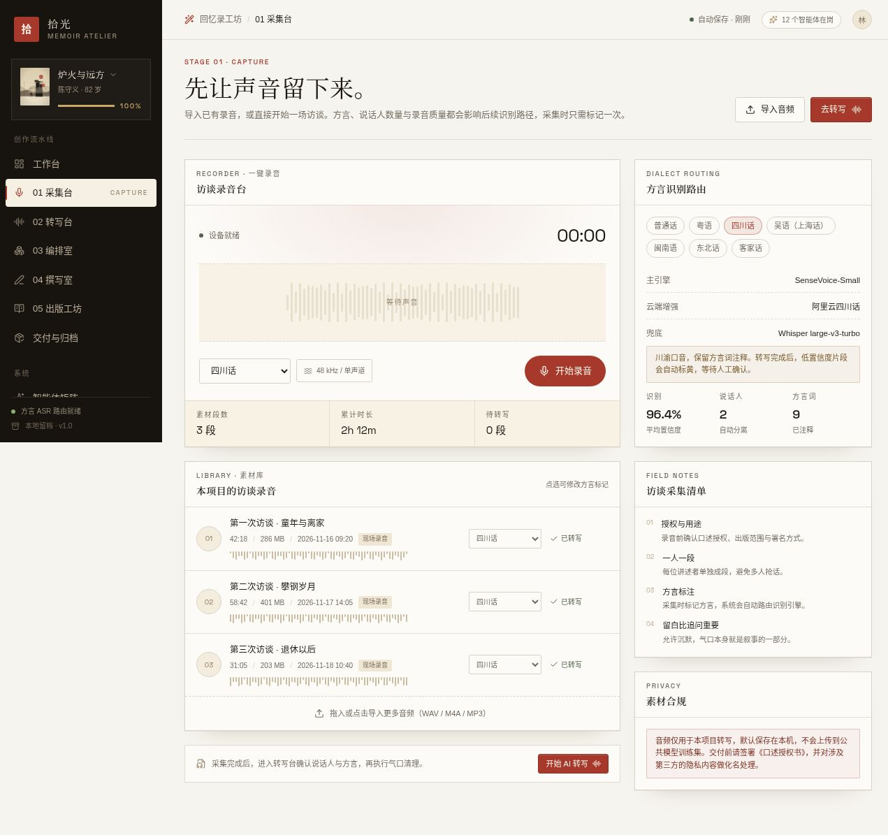

#### 02 转写台 · `/transcript`
逐句流式转写，说话人 / 时间 / 置信度，三档气口清理。

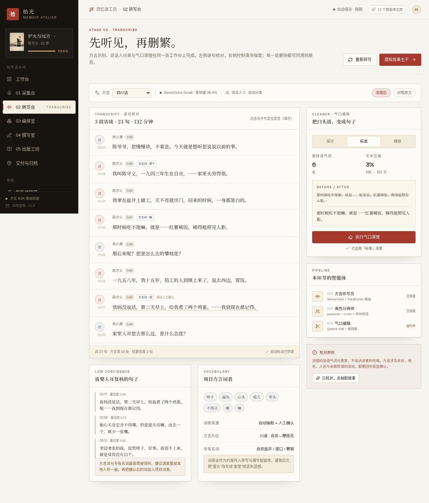

#### 03 编排室 · `/compose`
5 套叙事结构 × 5 种文风，故事主干与章节骨架。

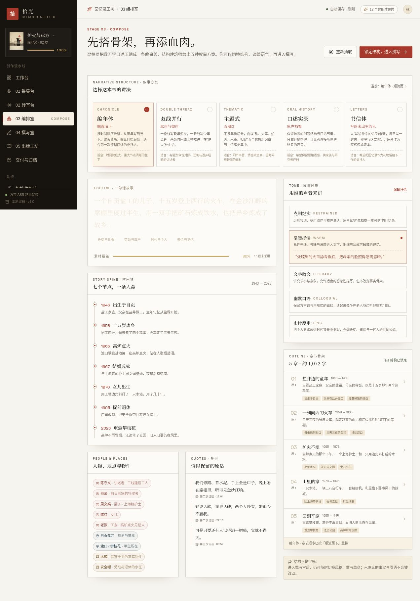

#### 04 撰写室 · `/write`
逐章流式生成，纸面编辑器直接修改，事实校对单独成块。

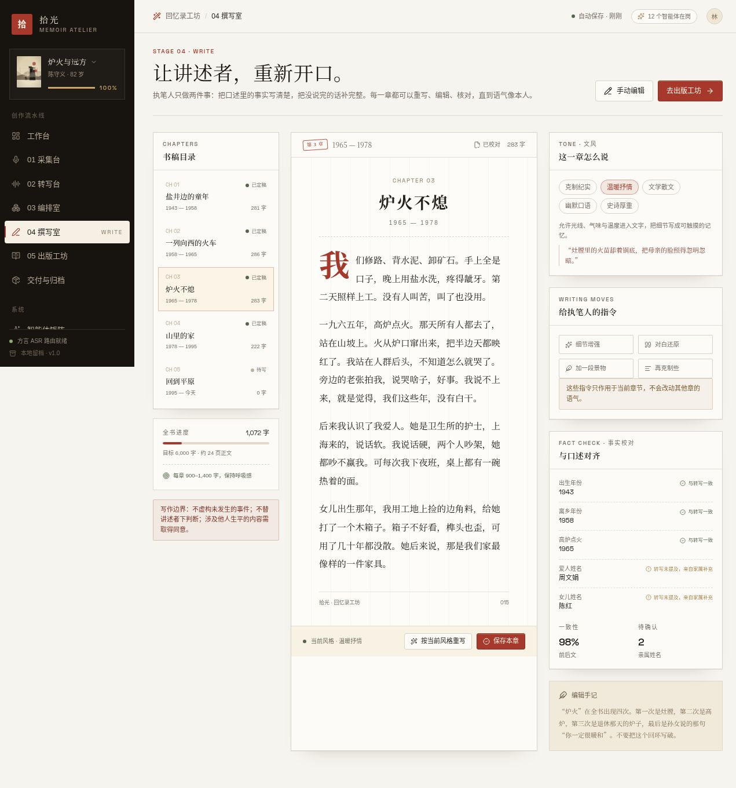

#### 05 出版工坊 · `/publish`
封面工作室、A5 对开预览、章节插图网格、印刷预估。

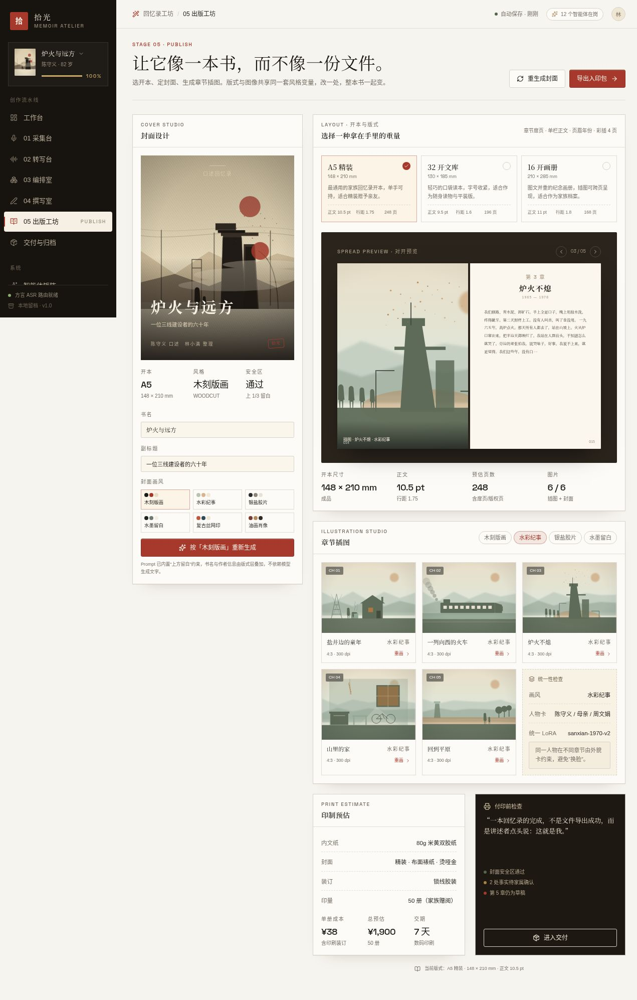

#### 交付与归档 · `/deliver`
4 类文件导出、ZIP 打包、推送 GitHub。

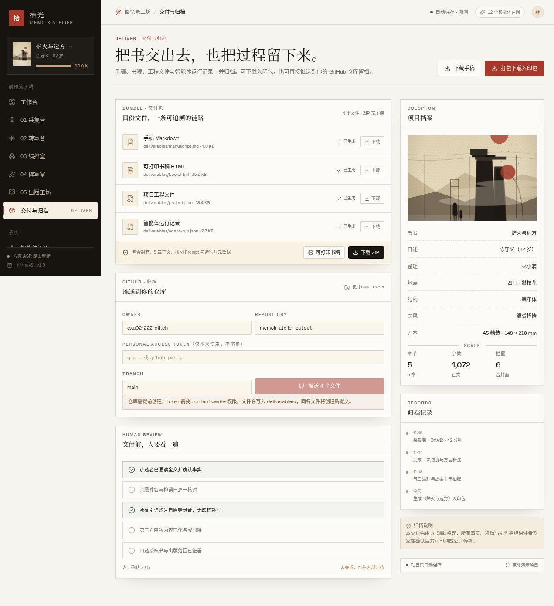

#### 智能体矩阵 · `/agents`
12 个智能体的职责、输入输出与默认模型全量说明。

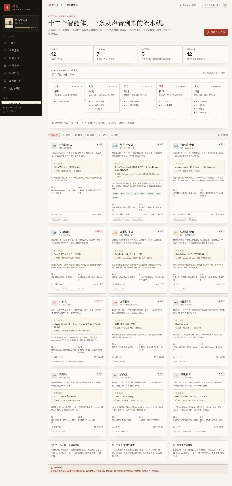

#### 模型设置 · `/settings`
文本 / 语音 / 图像三类，厂商→模型两级选择，三段式连通性测试。

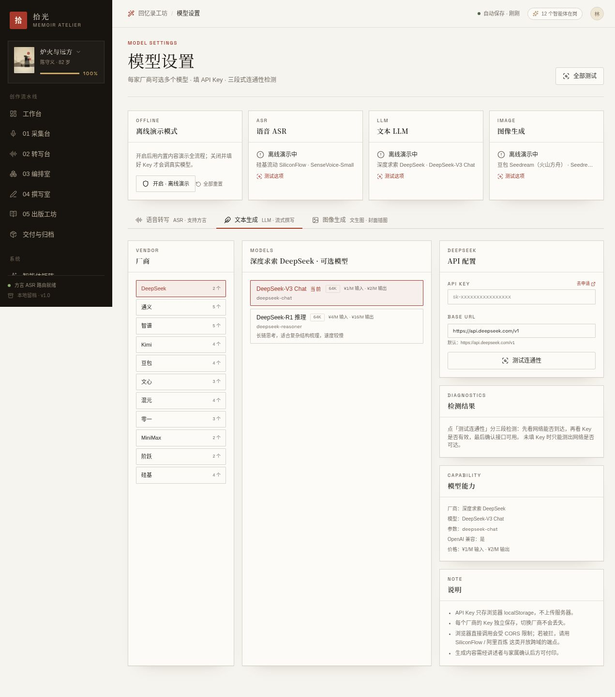

---

## 四、相关文档

- [智能体矩阵设计](./agent-matrix.md) — 12 个智能体的详细设计
- [国内模型选型清单](./model-provider-matrix.md) — 支持的厂商 / 模型与可达性实测
- [README](../README.md) — 快速开始与工程说明
